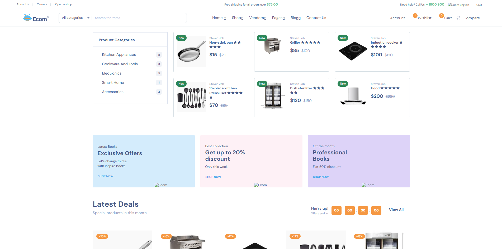
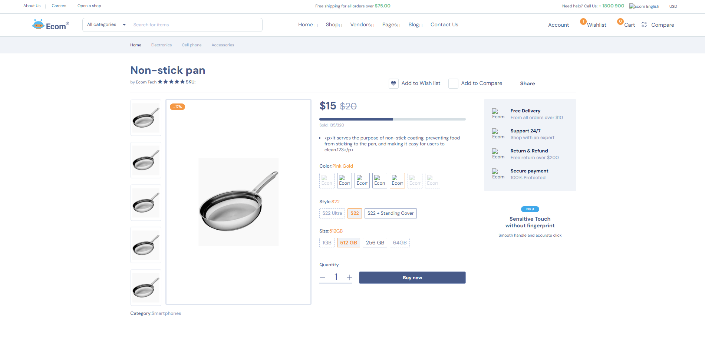
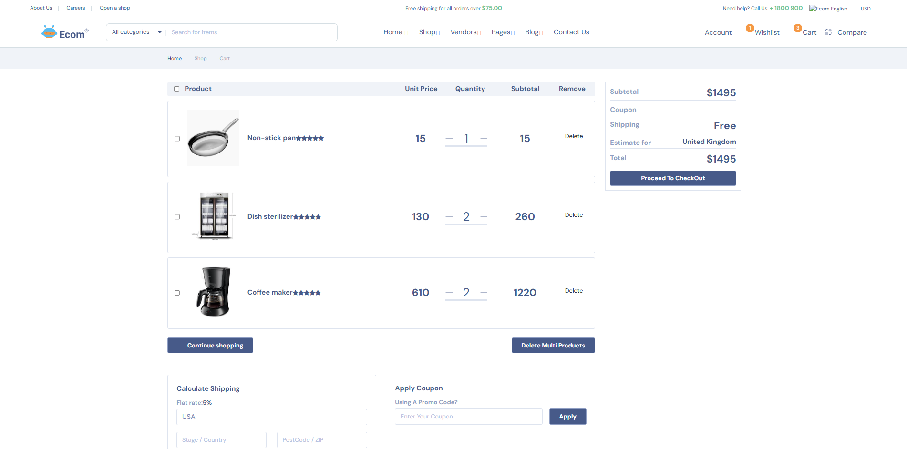
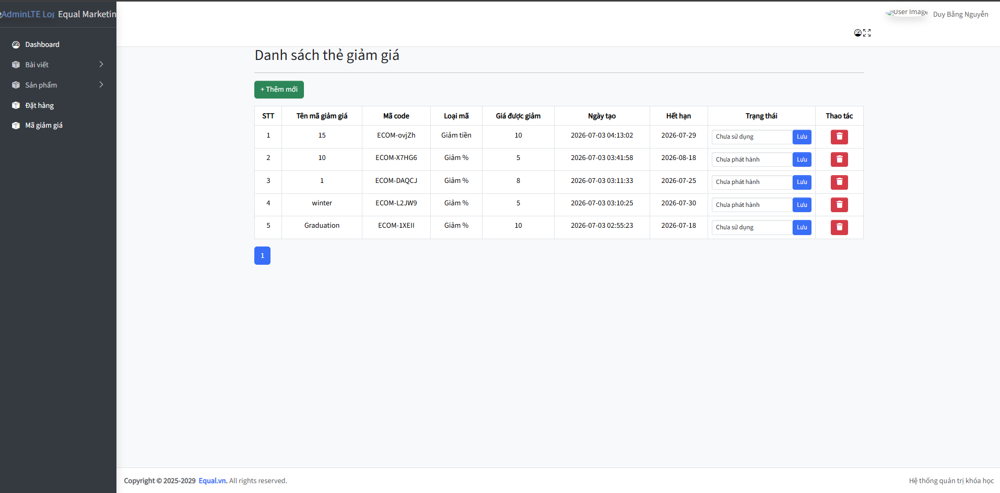
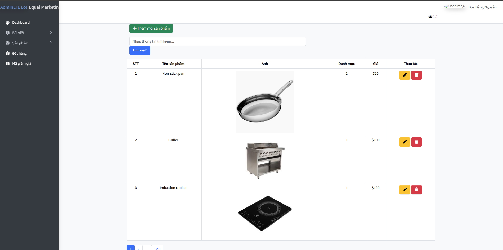
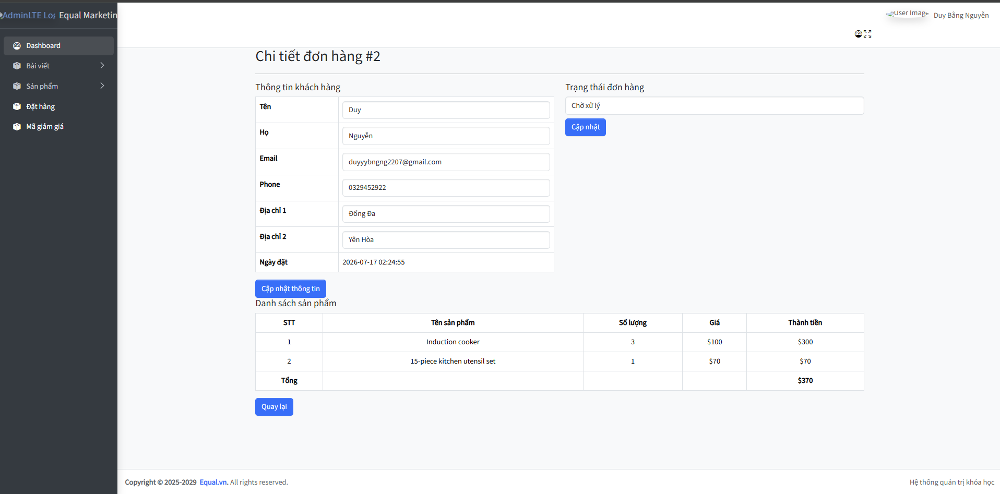

# 🛒 Project Ecom — Website thương mại điện tử (PHP thuần MVC)

Website bán hàng gồm **trang khách hàng** và **trang quản trị**, được xây dựng bằng **PHP thuần theo mô hình MVC tự viết**: tự viết Router, Base Controller, Core Model (PDO), không dùng framework.

**Công nghệ:** PHP 8 · MySQL (PDO) · MVC tự xây dựng · AJAX (jQuery) · Bootstrap · PHPMailer

| | |
|---|---|
| 🛍️ **Trang khách hàng** | [Xem chức năng ↓](#️-trang-khách-hàng) |
| 🔐 **Trang quản trị (Admin)** | [Xem chức năng ↓](#-trang-quản-trị-admin) |
| 🧱 **Kiến trúc MVC tự viết** | [Xem chi tiết ↓](#-kiến-trúc-mvc-tự-viết) |
| 🔑 **Tài khoản demo** | `demo@example.com` / `123456` |

---

## 🛍️ Trang khách hàng



- **Sản phẩm:** xem theo danh mục, **lọc theo khoảng giá**, trang chi tiết kèm đánh giá
- **Giỏ hàng (AJAX):** thêm, sửa số lượng, xóa sản phẩm mà không tải lại trang
- **Mã giảm giá (AJAX):** áp dụng hoặc gỡ coupon, tự tính lại tổng tiền
- **Wishlist (AJAX):** lưu sản phẩm yêu thích, xóa nhiều mục cùng lúc
- **Thanh toán:** nhập thông tin giao hàng, tạo đơn hàng
- **Tài khoản:** đăng ký, **kích hoạt qua email**, đăng nhập, **quên / đặt lại mật khẩu qua email**, sửa thông tin cá nhân
- **Blog:** danh sách bài viết, xem thêm bằng AJAX, tìm kiếm, bình luận

| Chi tiết sản phẩm | Giỏ hàng |
|---|---|
|  |  |

---

## 🔐 Trang quản trị (Admin)

Đăng nhập tại **`/login`**, tài khoản demo **`demo@example.com` / `123456`**.



- **Quản lý (thêm / sửa / xóa, tìm kiếm, phân trang):** Sản phẩm · Danh mục · Bài viết · Người dùng
- **Quản lý đơn hàng:** xem chi tiết, cập nhật thông tin và trạng thái đơn
- **Quản lý mã giảm giá:** tạo coupon, **sinh mã ngẫu nhiên bằng AJAX**, bật / tắt
- **Quản lý bình luận và đánh giá**

| Quản lý sản phẩm | Chi tiết đơn hàng |
|---|---|
|  |  |

---

## 🧱 Kiến trúc MVC tự viết

```
index.php            # Front controller: nạp config, core, models, controllers rồi chạy router
routers/web.php      # Khai báo route: $router->get('/url', 'Controller@method')
core/
├── router.php       # Router tự viết: ánh xạ URL + phương thức HTTP → Controller@method
├── BaseController.php
├── CoreModels.php   # Lớp Model gốc: các hàm truy vấn dùng chung (PDO)
├── connect.php      # Kết nối PDO (UTF-8, bắt lỗi bằng exception)
├── session.php      # Tiện ích session, flash message
└── functions.php    # Hàm tiện ích, gửi mail (PHPMailer)
app/
├── Controllers/     # Controller trang admin
│   └── clients/     # Controller trang khách hàng
├── Models/          # Products, Orders, Coupons, Users, Posts...
└── Views/           # Giao diện admin + khách hàng
config/              # Cấu hình database, mail
database/ecom_db.sql # Database đầy đủ + dữ liệu mẫu
```

**Bảo mật:** mật khẩu mã hóa bằng `password_hash` / `password_verify`, dữ liệu đầu vào được lọc qua `filterData()`, token kích hoạt và đặt lại mật khẩu, thông tin mail tách riêng khỏi code.

---

## ⚙️ Cài đặt và chạy

**Yêu cầu:** PHP 8+, MySQL 5.7+ / 8, Apache (bật `mod_rewrite`). Khuyên dùng **Laragon**.

1. Tải code vào thư mục web của Laragon:
   ```bash
   cd C:\laragon\www
   git clone https://github.com/duyyybngng2207-png/project-ecom.git
   ```
2. Tạo database tên `ecom_db`, rồi import file `database/ecom_db.sql`
3. Kiểm tra kết nối trong `config/config.php` (mặc định: `root`, mật khẩu rỗng)
4. **Cấu hình gửi mail** (để dùng chức năng kích hoạt tài khoản và quên mật khẩu):
   copy `config/mail.php.example` thành `config/mail.php`, rồi điền Gmail và [App Password](https://myaccount.google.com/apppasswords)
5. Khởi động lại Laragon, rồi mở **`http://project-ecom.test`**
   - Trang khách hàng: `http://project-ecom.test/`
   - Trang admin: `http://project-ecom.test/login` → `demo@example.com` / `123456`

> Dự án được cấu hình để chạy ở tên miền `project-ecom.test` (Laragon tự tạo). Nếu chạy ở địa chỉ khác, sửa `session.cookie_domain` trong `index.php`.

---

👤 **Tác giả:** Nguyễn Duy Bằng · GitHub [@duyyybngng2207-png](https://github.com/duyyybngng2207-png)
